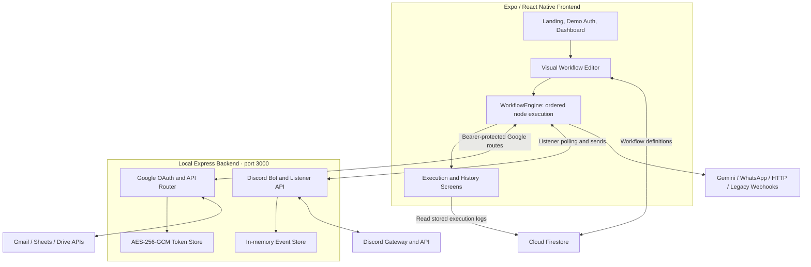

<div align="center">

# ⚡ FlowAutomate

### Connect your tools. Transform your data. Build your flow.

**A visual workflow automation workspace built with Expo, React Native, and Node.js.**

[](https://developer.mozilla.org/en-US/docs/Web/JavaScript)
[](https://expo.dev/)
[](https://reactnative.dev/)
[](https://nodejs.org/)
[](https://firebase.google.com/docs/firestore)
[](#license)

[Overview](#overview) · [Features](#features) · [Quick Start](#quick-start) · [Integrations](#integrations) · [Node Reference](#node-reference) · [Known Limitations](#known-limitations)

</div>

---

## Overview

**FlowAutomate** brings workflow design, data processing, and third-party actions into a single visual workspace. Build a pipeline from configurable nodes, connect conditional paths, transform data with JavaScript, and inspect execution results from the app.

The frontend combines a dark, responsive interface with a draggable workflow canvas and a Three.js-powered landing scene. A local Express backend handles Google OAuth, encrypted Google token storage, and live Discord bot events. Workflow definitions are stored in Cloud Firestore.

Typical flows include:

- **Document processing:** receive a new Discord attachment → extract structured data with Gemini → transform it → send the result to Gmail or Google Sheets.
- **Data operations:** fetch JSON from an API → evaluate an IF condition → send a Discord message or browser notification.
- **Batch preparation:** parse a simple CSV table → generate invoice text for each row → export or send the resulting data.

## Contents

- [Overview](#overview)
- [Features](#features)
- [System Architecture](#system-architecture)
- [Technology Stack](#technology-stack)
- [Source Snapshot and Setup Requirements](#source-snapshot-and-setup-requirements)
- [Quick Start](#quick-start)
- [Configuration Reference](#configuration-reference)
- [Integrations](#integrations)
- [Building Your First Workflow](#building-your-first-workflow)
- [Node Reference](#node-reference)
- [Expressions and Data Flow](#expressions-and-data-flow)
- [Example Workflows](#example-workflows)
- [Backend API Reference](#backend-api-reference)
- [Project Structure](#project-structure)
- [Testing](#testing)
- [Security and Privacy](#security-and-privacy)
- [Known Limitations](#known-limitations)
- [Troubleshooting](#troubleshooting)
- [Contributing](#contributing)
- [License](#license)

## Features

### 🎨 Visual workflow workspace

- **Node-based editor:** add, configure, remove, and reorder workflow steps.
- **Canvas controls:** drag nodes, preserve custom positions, and zoom from 40% to 160%.
- **Conditional paths:** attach nodes to TRUE or FALSE branches and skip inactive paths.
- **Searchable node picker:** find triggers, transformations, and integration actions.
- **Workflow management:** create, edit, enable, disable, delete, sort, import, and export workflows.
- **JSON portability:** export workflow JSON to the clipboard where supported; import by pasting JSON.

### 🔌 Connected tools

- **Google OAuth:** connect Gmail, Google Sheets, and Google Drive through the backend.
- **Gmail:** send plain-text emails with optional workflow-data attachments; search and read messages.
- **Google Sheets:** read a range or append a two-dimensional array of values.
- **Google Drive:** list app-accessible files and upload UTF-8 text or JSON.
- **Discord:** wait for new messages or attachments, then send channel messages or DMs.
- **Gemini:** extract JSON from text or downloaded attachments.
- **WhatsApp:** send text through the Meta WhatsApp Cloud API implementation.
- **HTTP:** call JSON endpoints from a workflow.

### 🧩 Data and execution

- JavaScript transformations with `input`, `steps`, and `items` available to the code node.
- Simple CSV-to-JSON conversion and batch invoice-text generation.
- Step-output expressions such as `{{prev.output}}` and `{{step_2.output.email}}`.
- Execution logs with success, failure, skipped, and waiting states.
- In-memory pause/resume scaffolding for approval decisions.
- Firestore services for workflow storage and execution-log retrieval.

> A node appearing in the picker does not necessarily mean it is implemented in the main runner. The reference below distinguishes working execution paths from placeholders.

## System Architecture



**Execution model:** workflows run in the frontend, not in an independent backend worker. Nodes are processed in array order. `parentId` determines upstream input, while `targetBranch` controls conditional eligibility. The backend provides integration services; it is not a durable workflow scheduler.

## Technology Stack

| Layer | Technology | Role |
| --- | --- | --- |
| Frontend | JavaScript, React, React Native, Expo | Application UI and web development runtime |
| Navigation | React Navigation native stack | Landing, auth, dashboard, editor, configuration, execution, history |
| Visuals | React Native SVG, Three.js | Icons, workflow connectors, WebGL hero scene |
| Data | Firebase Cloud Firestore | Workflow documents and execution-log service functions |
| Backend | Node.js ≥ 22.12.0, Express 5 | Local integration API |
| Discord | discord.js 14 | Bot connection and live event handling |
| Configuration | dotenv, cors | Backend environment loading and browser-origin allowlist |
| Google security | Node.js cryptography | PKCE, OAuth state, AES-256-GCM token encryption |
| Tests | Node.js built-in test runner | Backend, integration contract, and local HTTP tests |

Frontend dependency versions cannot be verified because the root `package.json` and lockfile are absent from the supplied archive. The backend manifest specifies Express `^5.3.0`, discord.js `^14.22.1`, cors `^2.8.6`, and dotenv `^16.6.1`.

## Source Snapshot and Setup Requirements

The archive includes the application source and a separately installable backend, but it is **not a complete frontend checkout**.

| Item | In the uploaded archive? | Why it matters |
| --- | --- | --- |
| `App.js`, `index.js`, `metro.config.js`, `src/` | Yes | Frontend source and entry points |
| `flowautomate-proxy/package.json` and lockfile | Yes | Reproducible backend dependency installation |
| Root `package.json` and `package-lock.json` | No | Required to restore compatible frontend dependencies and scripts |
| `app.json` | No | Original Expo application configuration |
| `assets/` and `public/` | No | Referenced fonts, icons, and WebGL resources |
| Root `LICENSE` and ignore files | No | License text and repository hygiene |

`structure.txt` lists files from a larger working tree, including the omitted items. Treat it as a reference, not proof that those files are bundled. In particular, restore `public/webgl/clean-cube/` for the hero scene's default asset path.

**Recommended starting point:** restore the missing files from the original project. Do not choose arbitrary Expo/React Native versions and assume they match this source. Once the original manifest is restored, use its declared dependencies and Expo-compatible versions.

## Quick Start

### Prerequisites

- **Node.js ≥ 22.12.0** and npm for the backend.
- The complete frontend checkout with its original Expo configuration and dependency manifests.
- A Firebase project with Cloud Firestore for persistent workflow storage.
- Optional integration accounts: a Google Cloud project, Discord application/bot, Gemini API key, or WhatsApp Cloud API setup.
- A modern browser for the documented web-first development flow.

### 1. Install and configure the backend

From the project root:

```bash
cd flowautomate-proxy
npm ci
cp .env.example .env
```

On Windows PowerShell, use `Copy-Item .env.example .env` instead of `cp` if preferred.

Generate two independent secrets:

```bash
# Copy the output into GOOGLE_TOKEN_ENCRYPTION_KEY.
node -e "console.log(require('node:crypto').randomBytes(32).toString('hex'))"

# Run separately; copy this output into GOOGLE_DEMO_API_KEY.
node -e "console.log(require('node:crypto').randomBytes(32).toString('hex'))"
```

Edit `.env` using the [configuration reference](#configuration-reference). Google credentials are needed only for Google operations. Leave `DISCORD_BOT_TOKEN` unset if you only need Google integration.

```bash
npm start
```

The backend defaults to `http://localhost:3000`, bound to `127.0.0.1`. Without a Discord token, it starts in Google-only mode with Discord offline.

### 2. Configure Firebase

1. Create or select your own Firebase project.
2. Register a web app and create a Cloud Firestore database.
3. Replace the existing project-specific configuration in `src/services/firebase.js` with your own Firebase web app configuration.
4. Set appropriate Firestore Security Rules before using real data. **Do not enable unrestricted public read/write access.**

The service layer uses these collections:

| Collection | Contents |
| --- | --- |
| `workflows` | Workflow definitions, node configuration, enabled state, and canvas positions |
| `execution_logs` | Execution documents read by the History screen; recording is not fully wired in this snapshot |

The current service does not namespace documents by user. If the workflow collection is empty, it attempts to seed `INITIAL_WORKFLOWS`; failed reads fall back to that local array. This fallback is not durable offline storage.

### 3. Start the frontend

After restoring the missing frontend files, open a second terminal at the project root:

```bash
npm ci
npx expo start --web
```

If the restored project does not include a root lockfile, use `npm install` instead of `npm ci`.

Optionally create a root `.env`:

```dotenv
EXPO_PUBLIC_FLOWAUTOMATE_API_URL=http://localhost:3000
```

Use the URL printed by Expo. The backend allows `http://localhost:8081` and `http://localhost:19006` by default; add your actual origin to `FRONTEND_ORIGINS` when different.

> [!NOTE]
> The frontend cannot be launched reproducibly from the uploaded archive alone. Also address the scheduler's missing `saveExecutionLog` export described under [Known Limitations](#known-limitations), which may surface during frontend bundling.

### 4. Open the workspace

Navigate from the landing page through the demo authentication screen to the dashboard. The login and Google sign-in buttons on that screen are **UI simulations**, not identity verification. Connecting Google inside a Google node is a separate, real backend OAuth flow.

## Configuration Reference

### Backend: `flowautomate-proxy/.env`

```dotenv
# Local HTTP server
PORT=3000
HOST=127.0.0.1
FRONTEND_ORIGINS=http://localhost:8081,http://localhost:19006

# Optional: enable Discord bot integration
DISCORD_BOT_TOKEN=replace_with_your_discord_bot_token

# Required when using Google integrations
GOOGLE_CLIENT_ID=replace_with_your_web_client_id
GOOGLE_CLIENT_SECRET=replace_with_your_web_client_secret
GOOGLE_REDIRECT_URI=http://localhost:3000/api/google/oauth/callback
GOOGLE_TOKEN_ENCRYPTION_KEY=replace_with_exactly_64_hex_characters
GOOGLE_DEMO_API_KEY=replace_with_an_independent_random_secret_at_least_32_characters
```

Remove or leave empty the Discord token variable for Google-only use; do not leave a placeholder token in place.

| Variable | Default / requirement |
| --- | --- |
| `PORT` | `3000` |
| `HOST` | `127.0.0.1`; loopback-only by default |
| `FRONTEND_ORIGINS` | Comma-separated exact browser origins; defaults to the two localhost origins above |
| `DISCORD_BOT_TOKEN` | Optional; server-side only |
| `GOOGLE_CLIENT_ID` | Required for Google OAuth; Web application client ID |
| `GOOGLE_CLIENT_SECRET` | Required for Google OAuth; server-side only |
| `GOOGLE_REDIRECT_URI` | Defaults to the localhost callback shown above; must exactly match Google Cloud registration |
| `GOOGLE_TOKEN_ENCRYPTION_KEY` | Exactly 64 hexadecimal characters; keep stable across restarts |
| `GOOGLE_DEMO_API_KEY` | Random bearer secret, at least 32 characters; missing/short values disable Google routes |

### Frontend

| Setting | Location | Behavior |
| --- | --- | --- |
| `EXPO_PUBLIC_FLOWAUTOMATE_API_URL` | Root `.env` | Default Google/Discord backend address; falls back to `http://localhost:3000` |
| Backend URL override | Integration node configuration | Overrides the default for that node |
| Google demo API key | Google node connection UI | Kept in frontend memory; re-enter after reload |
| Firebase configuration | `src/services/firebase.js` | Currently a source-level configuration object, not environment-variable driven |
| Gemini / WhatsApp credentials | Node configuration | Used directly by the client; handle as sensitive workflow data |

Never put server secrets in `EXPO_PUBLIC_*` variables: these values are exposed to the frontend bundle.

## Integrations

### Google: Gmail, Sheets, and Drive

1. Create a Google Cloud project and enable the **Gmail API**, **Google Sheets API**, and **Google Drive API** for the services you intend to use.
2. Configure the OAuth consent screen. If your app is in testing, add your account as a test user where required.
3. Create an OAuth client of type **Web application**.
4. Register this authorized redirect URI for the default local setup:

   ```text
   http://localhost:3000/api/google/oauth/callback
   ```

5. Set the Google backend environment variables and restart the backend.
6. Add a Google node, open its configuration, enter the backend API key, and connect the relevant service.
7. Complete consent, then return to the app and check connection status.

| Service | Requested scopes | Supported operations |
| --- | --- | --- |
| Gmail | `https://www.googleapis.com/auth/gmail.send`, `https://www.googleapis.com/auth/gmail.readonly` | Send plain-text mail, attach workflow output, search/read mail |
| Sheets | `https://www.googleapis.com/auth/spreadsheets` | Read values; append rows using `RAW` input and `INSERT_ROWS` |
| Drive | `https://www.googleapis.com/auth/drive.file` | List app-accessible files; upload text/JSON |

Connections accumulate service scopes. This backend maintains **one shared Google account**, not a separate account per workflow or frontend user. Disconnecting removes the connection for all Google services on that backend.

**Important behavior:**

- Gmail read is a search when the node runs, not an incoming-email trigger. It decodes plain-text MIME bodies; it does not extract mail attachments.
- Drive's `drive.file` scope does not expose the account's entire Drive. There is no file picker in this snapshot.
- Sheets append expects a two-dimensional array such as `[["Alice", 42], ["Bob", 17]]`, not an array of objects.
- Google tokens are encrypted at `flowautomate-proxy/.data/google-tokens.enc`. Preserve the encryption key across restarts. A lost key cannot decrypt an existing store.
- Remote Google backend URLs require HTTPS. Callback HTTP is allowed only for `localhost` or `127.0.0.1`; the callback path must remain `/api/google/oauth/callback`.

### Discord

1. Create an application and bot in the [Discord Developer Portal](https://discord.com/developers/applications).
2. Enable **Message Content Intent** in the bot settings.
3. Invite the bot to your server and grant the permissions needed for your workflow: **View Channel**, **Send Messages**, and **Attach Files** as applicable. Threads require appropriate access as well.
4. Put the token in the backend `.env` as `DISCORD_BOT_TOKEN` and restart the backend.
5. Enable Discord Developer Mode, then copy the channel or user ID you need.
6. Configure the workflow node with the backend address and target ID.

**Live trigger semantics:** start the workflow first. After **Listening** appears, post a **new** message or upload a **new** attachment in the configured channel. Historical messages are not replayed. Bot and webhook messages are ignored to prevent feedback loops.

| Setting | Behavior |
| --- | --- |
| `eventMode` | `attachment` by default; `message` accepts new messages or files |
| `timeoutSeconds` | Default `120`; integer range `10–600` |
| `channelId` / `targetId` | Discord ID string containing 17–20 digits |
| Send actions | `send_channel_message`, `send_direct_message` |
| Text limit | 2,000 characters |
| Outgoing attachment limit | 8 MiB decoded data |

Listeners are in memory and disappear on backend restart. Concurrent listeners receive their own copies of eligible events. DMs can fail if Discord privacy settings or shared-server requirements prevent delivery.

### Gemini AI extraction

Add a **Gemini AI Extraction** node after a text-producing or attachment-producing step. Configure an API key and a prompt describing the expected JSON fields.

```text
Extract each line item as an object with description, quantity, and amount.
Return a JSON array. Preserve numeric values as numbers.
```

The main runner uses `gemini-flash-latest` through the Gemini `v1beta` API. It can send extracted text or download an upstream `fileUrl` and submit inline base64 content. MIME inference explicitly recognizes `.pdf` and `.csv`, otherwise defaulting to `text/plain`.

The response is parsed as JSON after removing Markdown fences. The prompt requests an array, but the parser does not enforce an array schema. Review AI output before using it for consequential actions. Model availability, provider quotas, browser access to attachment URLs, and file suitability still apply.

### WhatsApp Cloud API

The `whatsapp_send` node requires `phoneId`, `token`, `to`, and `message`. The current implementation sends a plain-text request directly from the frontend to:

```text
https://graph.facebook.com/v19.0/{phoneId}/messages
```

Configure a valid Meta WhatsApp Business setup, authorized recipient, and token. Provider messaging-window, template, and account rules still apply. This source pins Graph API `v19.0`; check its current support and update the code if needed before relying on it. There is no template-message or media-message implementation in this node.

### Legacy email webhooks

- `inbound_email` polls an external JSON endpoint, up to 20 attempts with three-second waits. It accepts pre-extracted text or a legacy base64 CSV attachment response.
- `gmail_send` retains a legacy Apps Script webhook path alongside the Google OAuth path.
- The archive does **not** include the external listener, Apps Script deployment, or OCR implementation. A webhook URL alone does not create these services.

## Building Your First Workflow

1. Open the dashboard and create a workflow.
2. Keep the **Manual Trigger** as the first node.
3. Add **Set Data / Transform** and enter:

   ```json
   { "name": "FlowAutomate", "message": "My first workflow" }
   ```

4. Add **Code / JavaScript**:

   ```javascript
   return {
     ...input,
     message: input.message.toUpperCase(),
     processedAt: new Date().toISOString()
   };
   ```

5. Save the workflow and run it from the editor.
6. Inspect the execution output for the transformed object.

This example needs no third-party action credentials. Saving the workflow still depends on working Firestore configuration.

## Node Reference

### Implemented in the main workflow runner

| Node type | Purpose | Main configuration / behavior |
| --- | --- | --- |
| `manual_trigger` | Start a manual run | Returns a trigger timestamp |
| `timer_trigger` | Delay a run | `delaySeconds`; the node itself waits during execution |
| `set_data` | Define data | `jsonData`, with a `value` fallback |
| `javascript_code` | Transform input | `code`; synchronous function with `input`, `steps`, `items` |
| `csv_to_json` | Parse simple CSV | `csvText`; comma splitting, not a full CSV parser |
| `loop_invoice_generator` | Generate invoice text | Maps an input array to invoice records; email delivery is mocked |
| `http_request` | Fetch JSON | `method`, `url`, `body`; runner includes a body for POST/PUT |
| `if_condition` | Route TRUE/FALSE paths | `field`, `operator`, `compareValue` |
| `local_storage` | Browser key/value storage | `operation`, `key`, `value`; browser-only persistence |
| `notification` | Browser notification | `title`, `message`; requires permission and browser support |
| `wait_for_approval` | Suspend execution | `prompt`, `approverEmail`; demo resume UI, with caveats below |
| `gemini_extraction` | Extract JSON with Gemini | `apiKey`, `prompt` |
| `gmail_send` | Send mail | OAuth: `to`, `subject`, `body`, `attachData`, `fileName`; optional legacy webhook path |
| `gmail_read` | Search/read mail | `query`, `maxResults`, optional `pageToken` |
| `google_sheets` | Read/append values | `action`, `spreadsheetId`, `range`, `values` |
| `google_drive` | List/upload files | `action`, `query`, `maxResults`, `fileName`, `mimeType`, `folderId`, `content` |
| `discord_trigger` | Wait for a live event | `channelId`, `eventMode`, `timeoutSeconds`, optional `backendUrl` |
| `discord_action` | Send channel message or DM | `action`, `targetId`, `message`, `attachData`, `fileName` |
| `whatsapp_send` | Send WhatsApp text | `phoneId`, `token`, `to`, `message` |
| `inbound_email` | Poll an external email listener | `webhookUrl`; external service required |

### Picker entries that are not implemented in the main runner

| Node type | Snapshot behavior |
| --- | --- |
| `battery_sensor` | Appears in picker; no main-runner implementation |
| `network_status` | Appears in picker; no main-runner implementation |
| `device_info` | Appears in picker; no main-runner implementation |
| `json_transform` | Implemented in the separate `NodeExecutor.js`, not in `WorkflowEngine.js` |

The main runner's default case passes upstream input through, so unsupported types can appear successful without performing the advertised operation. `NodeExecutor.js` also contains a `battery_check` implementation, but that type differs from the picker's `battery_sensor`. The execution screen uses `WorkflowEngine.js`; the two implementations are not interchangeable.

## Expressions and Data Flow

Supported string expressions in fields wired to interpolation include:

```text
{{prev.output}}                 Entire active parent output
{{prev.output.email}}           A field from the active parent
{{step_2.output}}               Public output from step 2
{{step2.output.customer.name}}  Nested field from step 2
```

- Step numbers are **one-based positions in the node array**, not node IDs.
- `prev` means the effective parent node, not necessarily the previous item displayed on the canvas.
- Objects are JSON-stringified when inserted into strings; missing values become empty strings.
- Dot paths support nested properties and numeric array keys, such as `{{step_2.output.0.email}}`.
- Interpolation is field-specific, not a universal preprocessor. For example, the Set Data node parses its JSON configuration directly.
- Moving nodes changes step-number references. Keep parents before children: execution is sequential, not a topologically sorted parallel graph.

### JavaScript node context

```javascript
// input: active parent data
// steps: public outputs indexed by one-based step number
// items: input if already an array, otherwise [input]

return items
  .filter(item => Number(item.amount) > 100)
  .map(item => ({
    customer: item.clientName,
    total: Number(item.amount)
  }));
```

Code runs through `new Function` in the frontend. It is not sandboxed and the runner does not await asynchronous code-node results. Only run trusted, synchronous transformations.

### Conditions

Supported operators are `==`, `!=`, `>`, `<`, `contains`, and `not_contains`. Equality and text comparisons trim, remove surrounding quotes, and lowercase strings; numeric comparisons convert both sides to numbers.

IF nodes expose a boolean as their public step output, while passing the original input to the selected child branch. Nodes on the inactive branch are logged as skipped.

## Example Workflows

### 1. Discord attachment → Gemini → Google Sheets

```text
Discord Trigger → Gemini AI Extraction → JavaScript → Google Sheets (Append)
```

Start listening, upload a new file, and ask Gemini for objects with `description`, `quantity`, and `amount`. Transform them into Sheets rows:

```javascript
return items.map(row => [
  row.description,
  Number(row.quantity),
  Number(row.amount)
]);
```

Set the Sheets action to `append`, enter a spreadsheet ID and range, and leave explicit `values` unset to use the upstream two-dimensional array. Use a test sheet and review extraction accuracy first.

### 2. HTTP request → condition → Discord alert

```text
Manual Trigger → HTTP Request → IF Condition
                                  ├─ TRUE  → Discord Action
                                  └─ FALSE → Set Data
```

Point the HTTP node at a JSON endpoint. Compare a field such as `temperature` with a threshold. Attach the Discord action to the TRUE branch and interpolate the parent data in its message.

### 3. CSV → invoice records → Gmail attachment

```text
Manual Trigger → Parse CSV Table → Bulk Invoice Looper → Send via Gmail
```

Use CSV headers `Client Name`, `Email`, `Item`, and `Amount`. The invoice node produces an object containing `totalRowsProcessed` and `invoices`. Configure one Gmail send to attach that complete result.

**This is not per-customer delivery:** the invoice node generates plain text and marks `emailSentMock: true`; it does not create PDF invoices or send an email for each row.

### Portable workflow JSON

The dashboard importer requires `name` and a `nodes` array. This minimal example can be pasted into the import dialog:

```json
{
  "name": "Hello FlowAutomate",
  "description": "A minimal manual data workflow",
  "enabled": false,
  "nodes": [
    {
      "id": "trigger_1",
      "type": "manual_trigger",
      "label": "Manual Trigger",
      "parentId": null,
      "config": {}
    },
    {
      "id": "data_1",
      "type": "set_data",
      "label": "Set Data",
      "parentId": "trigger_1",
      "config": {
        "jsonData": "{\"message\":\"Hello from FlowAutomate\"}"
      }
    }
  ]
}
```

Import assigns a new workflow ID, appends `(Imported)` to the name, and disables the imported workflow. Exported JSON includes node configuration: remove credentials before sharing it.

## Backend API Reference

Base URL: `http://localhost:3000` by default. Browser origins must match `FRONTEND_ORIGINS`.

### Google routes

All Google routes except the OAuth callback require:

```http
Authorization: Bearer <GOOGLE_DEMO_API_KEY>
```

| Method | Endpoint | Purpose |
| --- | --- | --- |
| `POST` | `/api/google/auth/start` | Body `{ "service": "gmail" }`, `sheets`, or `drive`; returns `{ "url": "..." }` |
| `GET` | `/api/google/oauth/callback` | Provider callback with one-time OAuth state and code |
| `GET` | `/api/google/status` | Returns `connected`, `email`, `scopes`, and per-service connection flags |
| `POST` | `/api/google/execute` | Executes `{ "type": "...", "config": {}, "input": ... }` |
| `DELETE` | `/api/google/connection` | Revokes/removes the shared Google connection |

Supported execution types: `gmail_send`, `gmail_read`, `google_sheets`, `google_drive`.

| Operation | Enforced limits / defaults |
| --- | --- |
| Gmail send | One validated recipient; workflow attachment content up to 2 MiB |
| Gmail read | `maxResults` 1–20, default 10; optional pagination token |
| Sheets read | Default action `read`; default range `Sheet1!A:Z` |
| Sheets append | 1–1,000 rows; 1–100 scalar cells per row; up to 1 MiB values payload |
| Drive list | `maxResults` 1–100, default 20; default query `trashed = false`; optional pagination token |
| Drive upload | UTF-8 content up to 2 MiB; defaults to JSON MIME type and `workflow_output.json` |

Google backend requests time out after 20 seconds and responses are capped at 12 MiB. Client Google requests time out after 60 seconds. A timed-out send, append, or upload may already have completed: inspect the destination before retrying. Ambiguous mutations are not automatically retried; a GET receiving 401 can be retried once after refresh.

### Discord routes

| Method | Endpoint | Purpose |
| --- | --- | --- |
| `GET` | `/api/discord/status` | Returns bot readiness and username |
| `POST` | `/api/discord/listeners` | Create with `channelId`, optional `mode`, and `timeoutSeconds` |
| `GET` | `/api/discord/listeners/:id/events` | Poll for `waiting` or `success` with an event |
| `DELETE` | `/api/discord/listeners/:id` | Close a listener; returns HTTP 204 |
| `POST` | `/api/discord/send` | Send `targetId`, `action`, `messageContent`, optional base64 `fileContent` and `fileName` |
| `POST` | `/api/discord/fetch` | Retired historical-polling endpoint; returns HTTP 410 |

Discord routes have **no application-level bearer authentication** in this snapshot. Do not expose them on an untrusted network. An origin allowlist is not authentication.

## Project Structure

```text
.
├── App.js                         # Navigation and screen registration
├── index.js                       # Expo root registration
├── metro.config.js                # Metro config; GLB/GLTF asset extensions
├── structure.txt                  # Reference listing from a larger checkout
├── flowautomate-proxy/
│   ├── .env.example               # Backend configuration template
│   ├── package.json               # Backend scripts and dependencies
│   ├── package-lock.json
│   ├── server.js                  # Express server and Discord routes
│   ├── eventStore.js              # Live listener sessions and normalization
│   ├── googleIntegration.cjs      # OAuth, encrypted tokens, Google actions
│   ├── check-permissions.js       # Discord permission diagnostic helper
│   └── test/
│       ├── discord.test.cjs
│       └── google.test.cjs
└── src/
    ├── components/
    │   ├── GoogleNodeFields.js     # Google node configuration and connection UI
    │   ├── HeroScene.js            # Web-only Three.js scene wrapper
    │   ├── heroEngine.js           # Hero rendering and animation
    │   ├── originalCubeData.js
    │   ├── originalCubeMaterial.js
    │   ├── NodePicker.js           # Searchable node catalog
    │   ├── WorkflowCard.js
    │   └── WorkflowNode.js
    ├── engine/
    │   ├── WorkflowEngine.js       # Main runner used by the execution screen
    │   └── NodeExecutor.js         # Separate executor with different coverage
    ├── screens/
    │   ├── LandingScreen.js
    │   ├── AuthScreen.js           # Demo-only sign-in / sign-up UI
    │   ├── HomeScreen.js
    │   ├── EditorScreen.js
    │   ├── NodeConfigScreen.js
    │   ├── ExecutionScreen.js
    │   └── HistoryScreen.js
    ├── services/
    │   ├── discordService.js
    │   ├── firebase.js
    │   ├── googleService.js
    │   ├── historyStorage.js       # In-memory history helper
    │   ├── schedulerService.js     # Frontend timer scheduler; incomplete wiring
    │   └── workflowService.js      # Firestore CRUD and log service functions
    └── utils/
        └── mockWorkflows.js
```

Expected but not bundled: root `package.json`, `package-lock.json`, `app.json`, `LICENSE`, ignore files, `assets/`, and `public/`.

## Testing

Run the included backend suite:

```bash
cd flowautomate-proxy
npm ci
npm test

# Or run a specific suite:
node --test test/discord.test.cjs
node --test test/google.test.cjs
```

The package test script runs `node --test test/*.test.cjs`.

| Suite | Coverage |
| --- | --- |
| Discord | Event normalization, bot/webhook filtering, listener lifecycle, channel isolation, API validation, permissions errors, sends, CORS, and a local workflow-to-HTTP path |
| Google | Bearer checks, OAuth PKCE/state, redirect validation, scopes, encrypted persistence, refresh, Gmail MIME/read, Sheets/Drive actions, request limits, disconnect, and refresh races |

**Snapshot validation:** all **34 tests passed** during documentation preparation. Tests use mocked provider behavior and local HTTP requests; this does not certify live account configuration, frontend rendering, native compatibility, or production readiness. No frontend test script or complete frontend dependency manifest was supplied.

## Security and Privacy

### Safeguards already present

- Discord bot credentials stay on the backend; the frontend service deliberately does not forward legacy `botToken` fields.
- Google access/refresh tokens stay on the backend and are encrypted at rest with AES-256-GCM.
- Google OAuth uses PKCE S256 and expiring, one-time state.
- Google execution validates allowed services, actions, fields, and payload limits.
- Discord outgoing messages disable automatic mentions using `allowedMentions`.
- Backend request logging uses request paths rather than callback query strings, avoiding OAuth codes in those logs.
- Google mutation requests avoid automatic retries that could duplicate writes.

### Responsibilities before real-world use

1. **Keep the backend local by default.** Add real authentication and authorization before exposing any route, especially Discord routes.
2. **Replace demo authentication.** The current frontend login screen establishes no authenticated identity or access boundary.
3. **Protect Firestore.** Implement user-scoped data access and restrictive Security Rules; Firebase web configuration is not an authorization mechanism.
4. **Keep secrets out of workflows.** Gemini keys and WhatsApp tokens currently live in node config and can be saved to Firestore or exported. Move provider credentials server-side before multi-user deployment.
5. **Treat JavaScript nodes as executable code.** They run in the frontend without a sandbox. Do not run untrusted imported workflows.
6. **Review data destinations.** Documents and workflow output may be sent to Google, Discord, Gemini, Meta, or configured webhook/API endpoints.
7. **Do not commit `.env` or `.data/`.** The token encryption key, bearer key, and provider secrets must remain private. Add ignore rules because they are not bundled here.
8. **Use HTTPS remotely.** CORS limits browser origins; it does not stop direct non-browser requests.

## Known Limitations

These are implementation details of the supplied snapshot, not claims about an unseen full repository.

| Area | Current limitation |
| --- | --- |
| Frontend packaging | Missing root manifests, Expo configuration, and static assets prevent a reproducible frontend launch from this archive alone. |
| Authentication | Login, sign-up, and the auth-screen Google button simulate success after a short delay. They do not call Firebase Auth or verify identity. |
| User isolation | Firestore services use shared collections; the Google backend uses one shared account and bearer key. |
| Scheduling | Timers run in the frontend and stop when the runtime closes or is suspended. They are not durable background jobs. |
| Scheduler/history wiring | `schedulerService.js` imports `saveExecutionLog`, but `historyStorage.js` exports `saveExecutionRun` instead. Correct the contract and choose the intended persistence path before relying on scheduled logs. |
| Timer behavior | Scheduler interval has a five-second minimum, while the timer node also waits inside each run. There is no overlap guard, and changing a workflow does not refresh an already-registered timer's captured definition. |
| Execution history | `saveRunToFirestore` exists, but the current execution screen does not call it. The History screen reads Firestore, while the separate local helper is in-memory and includes a sample record. |
| Approvals | Decisions are local UI actions with a hard-coded approver value, not authenticated remote approvals. Resume state is not durable, and the UI does not update the approval node's `nodeOutputs`, so downstream parent-based input can miss the decision. |
| Approval routing | Both Approve and Deny resume execution; denial is not an automatic stop. A decision must be explicitly routed, and the resume-data wiring must be corrected first. |
| Node parity | Some catalog entries are pass-throughs in the main runner; `NodeExecutor.js` has different supported types and behavior. |
| CSV | Parsing splits lines and commas; quoted commas, escaped quotes, and multiline fields are not supported. |
| Invoice generation | Produces text records with mocked email status, not PDF generation or per-row email delivery. |
| Async code | JavaScript nodes are synchronous and unsandboxed. |
| HTTP | The main runner expects JSON responses and does not expose custom headers/auth or a general retry policy. Browser CORS still applies. |
| Browser features | WebGL, clipboard, local storage, notifications, and browser globals make native parity unverified. |
| Live Discord sessions | In-memory only; backend restarts invalidate listeners. |
| External integrations | Legacy email listener/OCR services are absent; WhatsApp API version support and live provider permissions need verification. |

## Troubleshooting

| Symptom | What to check |
| --- | --- |
| Root `npm ci` fails because there is no manifest | Restore the original root `package.json`, lockfile, and Expo config. The backend manifest cannot substitute for the frontend manifest. |
| Missing `saveExecutionLog` export | Align scheduler/history function names and their data contracts; see Known Limitations. |
| Hero scene is missing or reports texture errors | Restore the referenced static resources, especially `public/webgl/clean-cube/`, and check browser WebGL support. |
| Cannot reach the backend | Ensure it is running; check the node Backend URL, `EXPO_PUBLIC_FLOWAUTOMATE_API_URL`, port, and browser origin. |
| Frontend origin is rejected | Add the exact scheme, host, and port to `FRONTEND_ORIGINS`, then restart the backend. `localhost` and `127.0.0.1` are different origins. |
| Google returns 401 | Enter the matching `GOOGLE_DEMO_API_KEY` in the Google node UI; re-enter after frontend reload. |
| Google returns 503 | Check the bearer secret length and backend Google configuration. |
| OAuth reports redirect mismatch | Register the exact `GOOGLE_REDIRECT_URI` in the Web OAuth client, including port and callback path. |
| Consent or scope validation fails | Check test users, enabled APIs, requested permissions, and account policy; reconnect with the required service scopes. |
| Google connection cannot be decrypted | Restore the original encryption key or reset/reconnect the local Google connection. |
| Drive lists fewer files than expected | `drive.file` is intentionally restricted to app-accessible files, not the whole Drive account. |
| Sheets append rejects input | Supply a 2D array of scalar values, not objects, and check spreadsheet access and payload limits. |
| Discord reports offline | Verify the bot token, network connection, and Message Content Intent; restart the backend. |
| Discord trigger keeps waiting | Post after Listening appears, use the correct channel and mode, and use a human message rather than a bot/webhook message. |
| Discord cannot send or attach files | Check channel permissions, target ID, message size, and attachment size; DM privacy restrictions may also apply. |
| Gemini response cannot be parsed | Request JSON explicitly, inspect the returned text, and check model access, API quotas, and document format. |
| Workflow disappears or does not persist | Check the Firebase project, Firestore permissions, browser console, and swallowed service errors; local fallback is not persistence. |
| History is empty after a manual run | The execution screen does not currently save its run to Firestore; wire recording before expecting History entries. |
| Scheduled jobs stop after closing the tab | Expected: scheduling is frontend-based, not a server worker. |

```

FlowAutomate is distributed under the **GNU General Public License, version 3 or, at your option, any later version**, without warranty. The uploaded archive does not include the full `LICENSE` file; restore it from the project or add the applicable [GNU GPL v3 license text](https://www.gnu.org/licenses/gpl-3.0.html) before redistribution.

Third-party dependencies and visual assets may have their own licenses. FlowAutomate is not affiliated with or endorsed by Google, Discord, Meta, Expo, or Firebase.

---

<div align="center">

**FlowAutomate — turn connected steps into useful work.**

</div>
